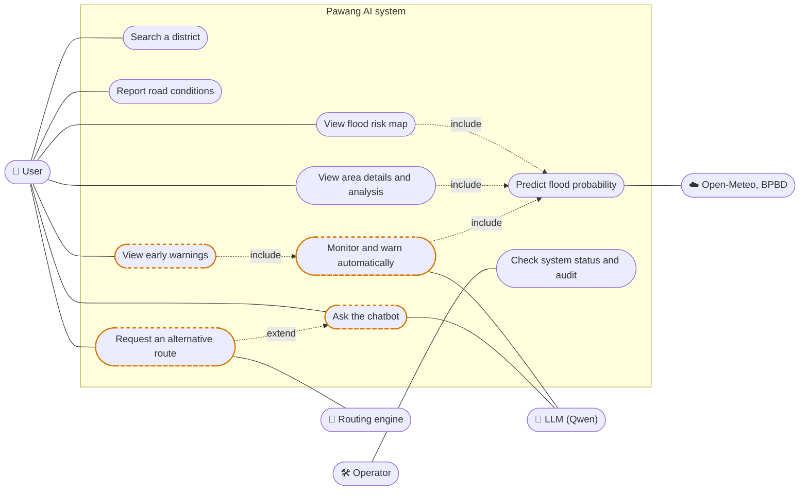
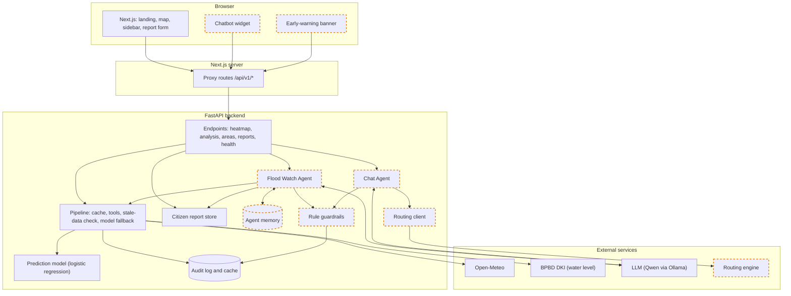
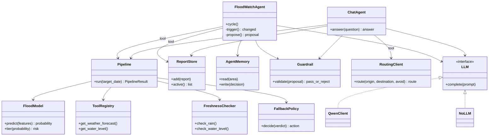
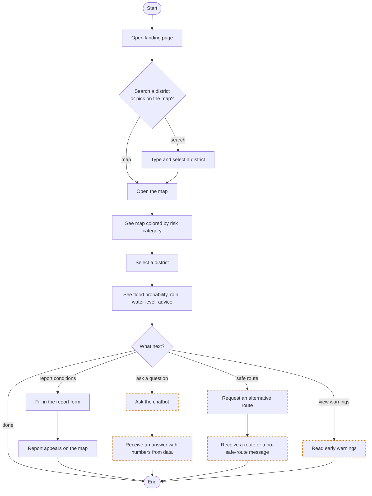
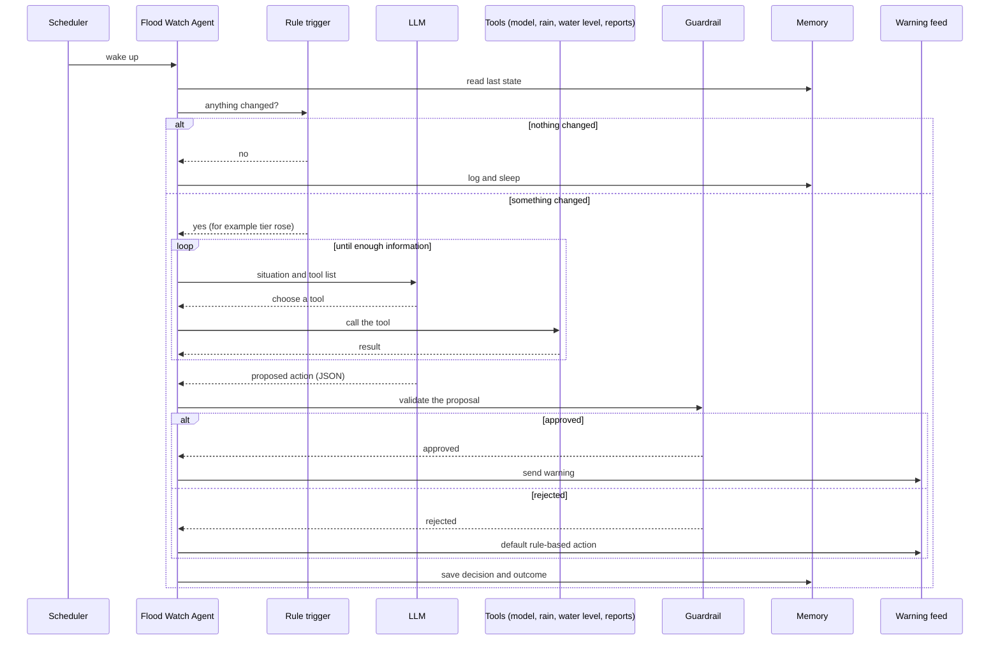
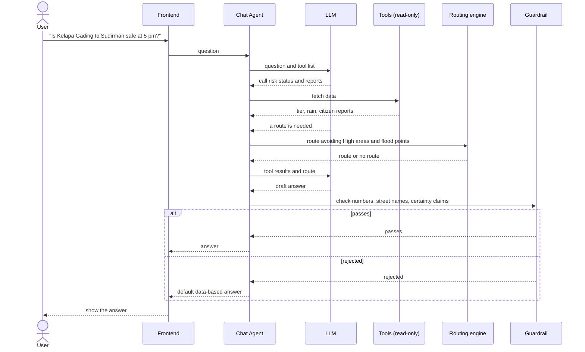

# Pawang AI: Agent, Chatbot, and Alternative Route Design

This document describes the design of the *Flood Watch Agent*, the chatbot, and the alternative-route feature of Pawang AI, together with UML diagrams of the current program architecture extended with these new components.

**Status:** components marked *(new)* are not built yet and are a design proposal. All other components already exist in the program. In the diagrams, dashed orange outlines mark *new* components.

---

## 1. Summary

Pawang AI predicts the flood probability of each district (kecamatan) in Jakarta from rainfall, water level, and elevation, and shows it on a map. Today the system is **reactive**: it only works when a user opens the map, it does not remember earlier events, and the three "agents" inside it run only within a single request.

This design adds one LLM-based agent that is **proactive, uses tools, and remembers context**:

> The **Flood Watch Agent** monitors data in the background, remembers earlier states, chooses by itself which tools to call, and proposes actions (for example an early warning). An action is executed only after it passes rule-based guardrails. Through a separate path, the same kind of agent also answers user questions (chatbot) and explains alternative routes.

Design principles:

- **The LLM chooses tools and proposes actions. Rules validate and execute.** The LLM has no direct write access.
- **Probabilities always come from the machine-learning model**, never from the LLM.
- **Routes are computed by a routing engine**, not by the LLM. The LLM only explains the result.
- **If the LLM is down or its output is rejected, the system keeps working** with default rule-based actions.

---

## 2. What the agent does in the program

### 2.1 Flood Watch Agent *(new)*, proactive

1. Wakes up on a schedule without waiting for a user (the interval adapts to conditions).
2. A **rule-based trigger** checks for changes: risk tier increased, water level rising fast, rainfall forecast shifted, citizen "flood" reports piling up, or a data source failing. If nothing changed, the LLM is **not called**.
3. If something changed, the LLM **chooses the tools** to call and reads their results.
4. The LLM **proposes an action**: send a warning, raise the level, request report verification, or do nothing.
5. The **rule-based guardrail** checks the proposal: schema, level cap, correctness of numbers, cooldown between warnings, and count limits.
6. Approved actions are **executed**: show an early warning on the web, prepare the cache for affected areas, adjust the monitoring interval.
7. The decision and its outcome are **saved to memory** and written to the audit log.
8. If the proposal is rejected or the LLM is unavailable, the **default rule-based action** runs.

### 2.2 Chatbot *(new)*, reactive

1. The user asks a question, for example "Is it safe to go from Kelapa Gading to Sudirman at 5 pm?".
2. The LLM picks tools: district risk status, rainfall forecast, water level, citizen reports, and a route when needed.
3. Tools are **read-only**, so the chatbot cannot change any data.
4. The answer is checked: numbers must come from tool results, there are no certainty claims ("it will definitely flood"), and risk wording matches the model tier.
5. A per-session question limit bounds LLM load.

### 2.3 Alternative route *(new)*

| Step | Done by |
|---|---|
| Find risky districts (High, or certain Medium-High) and citizen "flood" report points | **Rules**, from the model and citizen reports |
| Compute a route that avoids those areas | **Routing engine** (OSRM, Valhalla, or OpenRouteService, using OpenStreetMap) via API |
| Decide what to avoid, and when a route counts as too risky | **Rules** with thresholds set by the team |
| Explain the result ("via Jl. X because Jl. Y is flooded") | **LLM**, then checked that the street names exist in the route result |
| Decide whether a user question needs a route | **LLM** (tool choice) |

A route is never invented by the LLM. If no safe route exists, the system says so and shows no route.

### 2.4 Memory and guardrails *(new)*

- **Memory** (SQLite or a JSON file): last tier of each district, water-level trend, warning history, health of each data source, and the agent's decisions with their outcomes. The LLM reads it through a tool and never writes to it directly.
- **Guardrails**: typed JSON output, warning level never above what the model supports, numbers in text must come from tool results, cooldown between identical warnings (unless the level rises), and limits on the number of warnings and the monitoring interval.
- **Input safety**: citizen comments are treated as data, not instructions. All tools are read-only, so prompt injection through citizen text cannot write anything.

---

## 3. What happens to the old Agents 1 to 3

The current pipeline calls three agents inside one request. The new agent **does not automatically replace them**. What each one does and its fate:

| Old part | What it does | Fate |
|---|---|---|
| **Agent 1** (tool planner, `DataFetchOrchestrator`) | Chooses tools. The result is almost always the same. | **Removed.** Replaced by a fixed tool list. `check_plan` and one LLM call per request go with it. |
| **Agent 3** (`FreshnessChecker`) | Rejects stale data (rainfall older than 6 h, water level older than 3 h) | **Logic kept** as a plain function. Flood Watch still uses it as a tool. |
| **Agent 2** (`FailureHandler`) | Retries, falls back to the `rainfall_only` model, or reports "data unavailable" | **Logic kept** as rules. Its LLM branch is removed. |
| `AdviceWriter` | Writes Indonesian advice from the LLM or a template | Merged into the new agent, or replaced by a template if that is enough. |

Real savings: the LLM wrapper, `check_plan`, and the LLM branch of Agent 2, which are part of `agents.py` (287 lines), plus parts of `llm.py` and `guardrails.py`. Tests that change with it: `eval/check_agents.py` and part D of `eval/perf_test.py`.

**Condition:** removal happens **after** the new agent runs and passes its tests. Until then, the old agents are the only safeguard for stale data and fallback.

---

## 4. Division of work: rules, ML model, and LLM

| Part | Done by |
|---|---|
| Flood probability and risk tier | **ML model** (logistic regression) |
| "Did something change?" trigger | Rules |
| Stale-data check and model fallback | Rules |
| Choosing tools and their order | **LLM** |
| Interpreting conflicting signals (low rain, but water level rising and reports present) | **LLM** |
| Turning citizen comments into structured data | **LLM** |
| Proposing an action and its severity | LLM proposes, **rules cap it** |
| Writing warning text and chatbot answers | **LLM**, then checked by rules |
| Computing routes | **Routing engine** |
| Validation, warning cooldown, count limits, memory writes, execution | Rules |

---

## 5. UML diagrams

### 5.1 Use case diagram

Dashed orange: new features (early warnings, chatbot, alternative route, automatic monitoring).

### 5.2 Architectural overview diagram

### 5.3 Class diagram

`FreshnessChecker` and `FallbackPolicy` are the logic of the old Agent 3 and Agent 2, kept as plain functions. `NoLLM` is the no-LLM mode: the agent uses its default rule-based actions.

### 5.4 User activity diagram

### 5.5 Sequence diagram

#### a. Flood Watch Agent cycle (early warning)

#### b. Chatbot and alternative route

---

## 6. Limitations and unverified items

- The Flood Watch Agent, chatbot, alternative route, memory, and agent guardrails are **not built**. This document is a design only.
- Qwen's ability to choose tools correctly has **not been tested** (Ollama was not running during earlier testing). A small model (4B) is likely weak for multi-step flows and must be measured before it is chosen.
- The added value of an LLM agent over a rules-only version is **not yet proven**. Planned proof: replay the held-out test year 2020 day by day and compare precision, recall, and the number of warnings between the LLM agent and rules only. The model was trained on years before 2019, validated on 2019, and tested on 2020.
- The alternative route needs a **routing engine and evacuation-shelter data**, which do not exist yet. Their availability and licensing have not been checked.
- The change-trigger thresholds and warning-level limits are not set yet and must be chosen from data.
- The agent is proactive, so it must run on an always-on server with a single worker (memory and scheduler are kept per process).
- Citizen reports are unverified and do not feed the prediction model.

---

## 7. Helicopter view

### a. System purpose

A map-based web platform that displays a flood probability heatmap for the districts of Jakarta. For map requests the system is on-demand: the user selects an area and a time horizon, and the system fetches data, validates it, runs the prediction, and displays the heatmap. The proposed Flood Watch Agent adds a proactive background mode that monitors the same data and raises early warnings, and the chatbot and alternative-route features answer user questions on top of the same data.

| Aspect | Decision |
|---|---|
| Operating mode | On-demand for map requests; proactive background monitoring by the Flood Watch Agent *(new)* |
| Primary output | Flood probability heatmap per district (kecamatan), served as GeoJSON, in four risk categories (Low, Medium, Medium-High, High). Additional outputs: early warnings, chatbot answers, and alternative routes *(new)* |
| Prediction engine | Regularised logistic regression (C = 0.01, sigmoid calibration), with XGBoost as a benchmark |
| Agentic AI roles | LLM acts as the reasoning engine: it chooses tools, proposes actions, and writes text. The agents never calculate probabilities, and rules validate every proposed action *(new)* |
| Real-time data sources | Open-Meteo API (rainfall forecast and recent rainfall), BPBD DKI Jakarta water-level page (scraped) |
| Training data sources | Flood event history and water-level history from Satu Data Jakarta (satudata.jakarta.go.id); rainfall history from the Open-Meteo Archive API; elevation from Copernicus DEM; district boundaries from HDX (COD-AB Indonesia) |

### b. Actors and external systems

| Entity | Role |
|---|---|
| User | Searches or selects an area and time, views the heatmap, reports road conditions, and (new) asks the chatbot and requests alternative routes |
| Operator | Checks system status, the audit log, and agent behavior |
| Open-Meteo API | Weather forecasts and rainfall data (live), and historical rainfall (training) |
| BPBD DKI Jakarta | Water levels and river data, read from its public web page |
| Satu Data Jakarta | Historical flood events and water levels, used only for training the model |
| LLM (Qwen via Ollama) | Reasoning engine of the agents: tool choice, proposed actions, and text *(new in its extended role)* |
| Routing engine (OSRM, Valhalla, or OpenRouteService) | Computes routes that avoid risky areas *(new, not selected yet)* |
