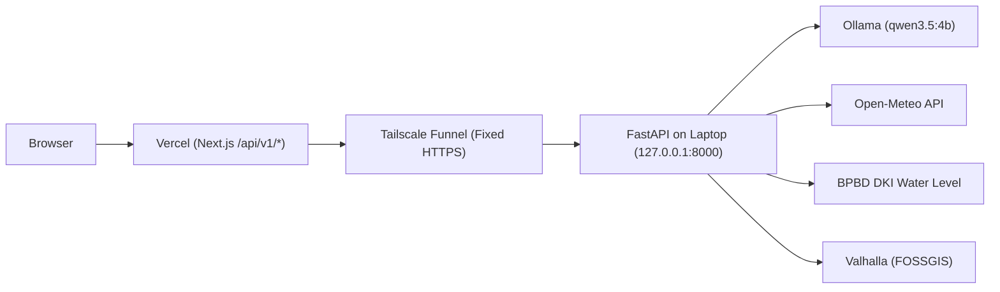

# Pawang AI Update · 28 November 2026

From: Reyhan (Coki) · To: Pawang AI dev team (Aidan, Abyan)

**Branch:** `feature/standby-backend` (branched from `fix/pre-deploy-2026-11-22` at `0d3deaf`; commits `6f2f642`, `7023d2c`, plus this note).

---

## 1. Summary

Until now, the FastAPI backend had to be started manually on Reyhan's laptop and exposed through a `cloudflared` quick tunnel whose URL changed on every restart, which broke `PAWANG_BACKEND_URL` on Vercel until someone updated and redeployed it. This update turns the Windows laptop into a self-starting standby server using Windows Task Scheduler, a PowerShell watchdog script, and Tailscale Funnel with a fixed HTTPS hostname (`https://laptop-khc450el.tailefd55f.ts.net`). After a full Windows reboot and logon — without typing any command — Ollama (`qwen3.5:4b`), FastAPI (`live` mode), and Tailscale Funnel come up automatically and serve real live data to `https://pawang-ai-eight.vercel.app` in under two minutes.

---

## 2. What Changed

All changes in this update are scripts and documentation only. **No file in `backend/app/` or `frontend/src/` was changed**, and all existing demo data and mock fallbacks (including `PAWANG_REPORTS_DEMO`'s default) were left untouched per team decision before tomorrow's presentation.

| File | What |
|---|---|
| `backend/scripts/start_all.ps1` | **New.** Starts and supervises Ollama (`qwen3.5:4b`), FastAPI (`uvicorn`, 1 worker, `live` mode), and Tailscale Funnel (with ngrok static-domain backup), with keep-awake (`ES_SYSTEM_REQUIRED`), log rotation, and a 30 s crash-recovery watchdog. |
| `backend/scripts/stop_all.ps1` | **New.** Cleanly stops the watchdog supervisor, `uvicorn`, and tunnel (`-KeepFunnel` and `-IncludeOllama` optional), using native `Get-Process` / `Stop-Process`. |
| `backend/scripts/status.ps1` | **New.** Read-only health check reporting supervisor state, Task Scheduler job, Ollama + model, local backend `/api/v1/health`, Tailscale Funnel + public HTTPS probe, and Windows AC sleep timeout. |
| `backend/scripts/install_task.ps1` | **New.** Registers the per-user Windows Task Scheduler job `PawangAI-Standby` (runs 15 s after logon, unlimited run time, up to 999 auto-restarts at 1 min intervals; no NSSM or admin rights required). |
| `backend/scripts/uninstall_task.ps1` | **New.** Removes the `PawangAI-Standby` Task Scheduler job (and optionally stops running processes with `-StopRunning`). |
| `docs/DEPLOYMENT.md` | **New.** Plain-English Windows setup and operations guide: Tailscale Funnel setup, ngrok backup, AC sleep prevention, Task Scheduler registration, Vercel `PAWANG_BACKEND_URL` update, reboot test checklist, and troubleshooting. |
| `docs/CLOUD_VM_PLAN.md` | **New.** Option B migration plan (documentation only, not executed) for moving the backend to an always-on cloud VM after the presentation. |
| `CHANGELOG.md` | **Updated.** Added the `2026-11-28` standby-backend entry and pointer to this update note. |
| `docs/updates/2026-11-28-standby-backend.md` | **New.** This team update note. |

---

## 3. How It Works Now



### Startup Order (`backend/scripts/start_all.ps1`)
1. **Keep-awake:** Calls Win32 `SetThreadExecutionState` (`ES_CONTINUOUS | ES_SYSTEM_REQUIRED` as `UInt32`) so Windows does not idle-sleep while the supervisor runs.
2. **Ollama (`127.0.0.1:11434`):** Gives Ollama's own logon app a 24 s grace period and reuses an existing listener if present; otherwise launches `ollama serve` and verifies/pulls `qwen3.5:4b` (or `QWEN_MODEL` from `backend/.env`).
3. **FastAPI (`127.0.0.1:8000`):** Starts `backend\.venv\Scripts\python.exe -m uvicorn app.main:app --host 127.0.0.1 --port 8000 --workers 1` (single worker required for cache, BPBD CSV lock, and Flood Watch memory) and waits up to 90 s for `/api/v1/health` to return `status=ok`.
4. **Tailscale Funnel:** Waits up to 5 minutes (`-TailscaleWaitSec 300`) for the Tailscale daemon to reach `Running`, ensures `tailscale funnel --bg 8000` is active, saves the fixed `https://...ts.net` URL, and probes `<url>/api/v1/health`.

### Auto-Start, Watchdog, Env Settings, and Logs
- **Task Scheduler (`PawangAI-Standby`):** Per-user job triggered at Windows logon (+15 s delay), `ExecutionTimeLimit = 0`, `MultipleInstances = IgnoreNew`, `RestartCount = 999` (1 min interval), runs on both AC and battery.
- **Watchdog loop (every 30 s):**
  - Checks Ollama `/api/tags` (8 s timeout); only restarts after 3 consecutive failures **and** port `11434` is not listening (avoids spawning duplicates when Ollama is busy on CPU).
  - Checks local `/api/v1/health`; restarts `uvicorn` on failure with backoff up to 120 s.
  - Performs a fast non-blocking Tailscale Funnel check and re-runs `tailscale funnel --bg 8000` if the mapping is missing.
- **Env settings set by `start_all.ps1`:**
  - `PAWANG_DATA_MODE=live`
  - `PAWANG_WATCH_INTERVAL_S=1800` (Flood Watch background cycle every 30 min)
  - `PAWANG_TMA_POLL_S=1800` (BPBD water-level history polled every 30 min)
  - `PAWANG_REPORTS_DEMO` is **not** set (keeps its current default). Secrets such as `PAWANG_ADMIN_TOKEN` remain in git-ignored `backend/.env` and are never logged or printed.
- **Logs (all in git-ignored `backend/logs/`):** `start_all.log`, `uvicorn.out.log`, `uvicorn.err.log`, `ollama.out.log`, `ollama.err.log`, `standby.pids.json`, and existing `audit-YYYY-MM-DD.jsonl`. Log files over 10 MB are rotated on startup.

---

## 4. Settings Changed Outside the Repo

These machine and hosting settings were configured directly on Reyhan's laptop and Vercel (not stored in git):

- **Windows AC power settings** (active `Turbo` power scheme, verified via `powercfg`):
  - AC sleep timeout (`STANDBYIDLE`): `0` (Never — previously 3 min)
  - AC hibernate timeout (`HIBERNATEIDLE`): `0` (Never)
  - AC lid-close action (`LIDACTION`): `0` (Do nothing)
- **Tailscale (`1.104.7`):** Installed via `winget`, signed in, MagicDNS/HTTPS + Funnel enabled on port `8000` at **`https://laptop-khc450el.tailefd55f.ts.net`**, and **Run unattended** turned on (`tailscale set --unattended=true`, verified `"ForceDaemon": true` in `tailscale debug prefs`).
- **Local `backend/.env`:** Configured a random 40-character alphanumeric `PAWANG_ADMIN_TOKEN` to protect `/api/v1/admin/agent-log` and `/api/v1/watch/*` (not committed or shared in docs).
- **Vercel Production (`https://pawang-ai-eight.vercel.app`):**
  - Replaced `PAWANG_BACKEND_URL` in Production with `https://laptop-khc450el.tailefd55f.ts.net`.
  - Confirmed `PAWANG_DEMO_DATE` is not set in Production.
  - Redeployed Production (`dpl_DG2ecfcbA6DeqTwYDPMbgsMt9o6n`).

---

## 5. How to Use

Run from the repository root (`C:\Users\Reyhan Batara\github\pawang-ai`):

```powershell
.\backend\scripts\status.ps1        # read-only health check of all components
.\backend\scripts\start_all.ps1     # start manually with 30 s watchdog
.\backend\scripts\stop_all.ps1      # stop supervisor, uvicorn, and Funnel (add -IncludeOllama to stop Ollama too)
.\backend\scripts\install_task.ps1  # register Windows Task Scheduler auto-start
.\backend\scripts\uninstall_task.ps1 # remove auto-start task
```

### If the site shows `"Backend tidak terhubung; data demo ditampilkan."`
1. Make sure the laptop is awake, plugged into AC power, signed in to Windows, and connected to the internet.
2. Run `.\backend\scripts\status.ps1` and check the first line that is `[DOWN]` or `[WARN]`:
   - **Backend `(:8000)` down:** inspect `Get-Content .\backend\logs\uvicorn.err.log -Tail 30`, then run `.\backend\scripts\stop_all.ps1` followed by `Start-ScheduledTask -TaskName "PawangAI-Standby"`.
   - **Tailscale Funnel down:** verify Tailscale is running and re-apply `tailscale funnel --bg 8000`, then probe `curl.exe https://laptop-khc450el.tailefd55f.ts.net/api/v1/health`.
   - **Public HTTPS probe `200 OK` but Vercel still shows demo data:** confirm `PAWANG_BACKEND_URL` in Vercel Production matches `https://laptop-khc450el.tailefd55f.ts.net` (no trailing slash) and redeploy.
   - *(Full guide in `docs/DEPLOYMENT.md`.)*

---

## 6. Verification

| Check | Result |
|---|---|
| Backend `pytest -q` | **139 passed** (21.99 s, 0 failures) |
| PowerShell syntax + `taskkill` check | All 5 `.ps1` scripts parsed cleanly (`OK`), `0` `taskkill` calls |
| `.\backend\scripts\status.ps1` | All checks `[UP  ]` / `[OK  ]` (Supervisor, `PawangAI-Standby`, Ollama `qwen3.5:4b`, Backend `mode=live` / `areas=44` / `llm_reachable=True` / `tma_rows=396`, Tailscale Funnel, Public HTTPS Probe `200 OK`, AC Sleep `0 s`) |
| Public Funnel health (`https://laptop-khc450el.tailefd55f.ts.net/api/v1/health`) | `HTTP/1.1 200 OK` (`"status":"ok"`, `"data_mode":"live"`, `"areas":44`, `"llm.reachable":true`) |
| Vercel status (`https://pawang-ai-eight.vercel.app/api/v1/status`) | `HTTP/1.1 200 OK` (`"source":"backend"`, `"data_mode":"live"`, `"demo_date":null`) |
| Live map (`https://pawang-ai-eight.vercel.app/map`) | Green connected indicator, live `2026-11-28` predictions across 44 kecamatan, and 4 active Flood Watch `Siaga` warnings |

### Reboot Test Results & Fixes
- **Reboot test #1 (`16:41`):** `PawangAI-Standby` launched automatically, but `backend/logs/start_all.log` caught three real boot-time issues:
  1. PowerShell 5.1 parsed `0x80000001` as signed `Int32` (`-2147483647`), causing a `System.UInt32` overflow in `SetThreadExecutionState`.
  2. Tailscale did not finish connecting within the initial 60 s wait.
  3. Ollama's own logon tray app raced with `start_all.ps1`, and a single 3 s `/api/tags` timeout triggered an unnecessary restart.
- **Fixes (`7023d2c` + Tailscale unattended mode):** Switched keep-awake flags to 64-bit literals `[uint32](0x80000000L -bor 0x00000001L)` (verified returning non-zero in PS 5.1), extended Tailscale startup wait to 5 min with a fast non-blocking 30 s Funnel watchdog, turned on Tailscale `Run unattended` (`ForceDaemon: true`), and added a 24 s Ollama startup grace period + 3-strike / port-`11434` check before restarting Ollama.
- **Reboot test #2 (`17:01:51` → `17:03:45`):** Clean hands-free pass with **0 warnings and 0 errors**. Keep-awake enabled (`17:01:52`), Ollama + `qwen3.5:4b` ready (`17:03:25`), FastAPI live (`17:03:44`), and Tailscale Funnel immediately verified `200 OK` (`17:03:45`) — **1 min 54 s** total from logon to live.

---

## 7. Limitations

- **Laptop dependency:** Live data is only served while Reyhan's laptop is powered on, signed in to Windows (`At logon` trigger), connected to the internet, and on AC power. When the laptop is shut down, Vercel falls back to demo data until the laptop boots and logs in again.
- **Public Valhalla server:** Alternative routing still points to `https://valhalla1.openstreetmap.de` (FOSSGIS public demo server; rate-limited, no SLA).
- **Qwen latency:** Local `qwen3.5:4b` speed depends on machine hardware (currently running on CPU when no CUDA/llama-server GPU backend is available, so uncached LLM calls take several seconds; responses are cached and rule-based fallbacks remain active if Qwen is slow or unreachable).
- **Tailscale key expiry:** Tailscale device keys expire after ~180 days by default unless **Disable key expiry** is toggled in the Tailscale Admin Console.

---

## 8. Next Steps

- **Always-on Cloud VM (Option B):** After the presentation, migrate the backend off the laptop following [docs/CLOUD_VM_PLAN.md](../CLOUD_VM_PLAN.md) (recommended: Oracle Cloud Always Free ARM VM with 24 GB RAM, choice of local Ollama vs hosted OpenAI-compatible Qwen API, and self-hosted Valhalla in Docker).
- **Postponed features (team decision for post-presentation):**
  - **Chat Agent:** `POST /api/v1/chat` with read-only tools, guardrails, and map chat widget (`AGENT_DESIGN.md` section 2.2).
  - **Live CCTV view:** Research and integrate official public Jakarta traffic CCTV feeds with source attribution and offline handling.
- **PR merge:** Open a PR from `feature/standby-backend` into `fix/pre-deploy-2026-11-22` when ready.
